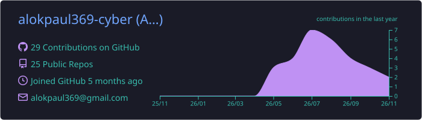
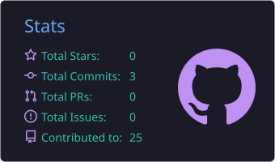
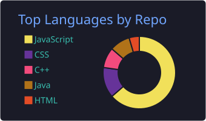
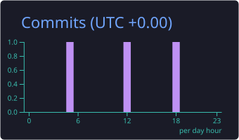

<!-- ============ HEADER ============ -->
<p align="center">
  
</p>

<p align="center">
  <a href="https://github.com/alokpaul369-cyber">
    
  </a>
</p>

<p align="center">
  
  
  
  
</p>

<br />

<!-- ============ ABOUT ============ -->
##  About Me


```javascript
const alok = {
  role:        "MERN FullStack Developer",
  education:   "B.Sc. in Computer Science & Engineering (Undergrad)",
  location:    "Bangladesh 🇧🇩",
  focus:       ["REST APIs", "Authentication", "React UIs"],
  learning:    ["C++ & DSA", "Next.js", "TypeScript"],
  hobbies:     ["Learning", "Exploring new tech", "Building & showcasing"],
  currently:   "Turning ideas into full-stack web apps",
};
```

- 🔭 Building **full-stack apps** and **secure backends** with the MERN stack
- 🧠 Sharpening problem solving with **C++** and **Data Structures & Algorithms**
- 🤝 Open to collaborating on **open-source** and **team projects**
- 💬 Ask me about **Node.js, Express, MongoDB, React** and **JWT auth**

<br clear="right" />

<!-- ============ TECH STACK ============ -->
## 🛠️ Tech Stack

<div align="center">

| | |
|:--:|:--|
| **Languages** |  |
| **Frontend** |  |
| **Backend** |  |
| **Database** |  |
| **Tools** |  |

</div>

<!-- ============ PROJECTS ============ -->
## 🚀 Featured Projects

<div align="center">

| Project | What it does | Built with |
|:--|:--|:--|
| 🏗️ [**Real World Backend System**](https://github.com/alokpaul369-cyber/Real-World-Backend-System) | Course platform API with JWT auth, enrollments, admin dashboard stats and Cloudinary image uploads |     |
| 💊 [**MediX: Medicine Finder**](https://github.com/alokpaul369-cyber/MEDIX-PROJECT) | Desktop app to find medicines at nearby pharmacies, with stock tracking, reservations, background jobs and reports |    |
| 🤖 [**AI Prompt Web App**](https://github.com/alokpaul369-cyber/AI-Prompt-Web-Application) | Ask anything and get answers from Llama 3.3 through a Node.js server built on the Groq API |   |
| 🌦️ [**SkyCast Weather App**](https://github.com/alokpaul369-cyber/Weather-App) | Weather website with live Open-Meteo data and a modern, responsive UI |    |
| 🎓 [**Advanced Student Management API**](https://github.com/alokpaul369-cyber/Advanced-Student-Management-API) | Secure MVC REST API with JWT-protected CRUD for student records |    |
| 🧮 [**DSA Problem Solve**](https://github.com/alokpaul369-cyber/DSA-Problem-Solve) | Searching, sorting and array algorithms implemented from scratch |  |

<a href="https://github.com/alokpaul369-cyber?tab=repositories">
  
</a>

</div>

<!-- ============ STATS ============ -->
## 📊 GitHub Analytics

<p align="center">
  
</p>

<p align="center">
  
  
</p>

<p align="center">
  
  
</p>

<p align="center">
  
</p>

<p align="center">
  <picture>
    <source media="(prefers-color-scheme: dark)" srcset="https://raw.githubusercontent.com/alokpaul369-cyber/alokpaul369-cyber/output/github-snake-dark.svg" />
    
  </picture>
</p>

<!-- ============ CONTACT ============ -->
## 🤝 Let's Connect

<p align="center">
  <a href="mailto:alokpaul369@gmail.com"></a>
  <a href="https://www.facebook.com/alokpal.alpha" target="_blank"></a>
  <a href="https://github.com/alokpaul369-cyber" target="_blank"></a>
</p>

<p align="center">
  <i>"First, solve the problem. Then, write the code."</i> — John Johnson
</p>

<p align="center">⭐ If you like my work, consider giving a repo a star! ⭐</p>

<!-- ============ FOOTER ============ -->
<p align="center">
  
</p>
